<a id="codex-atelier"></a>

<div align="center">

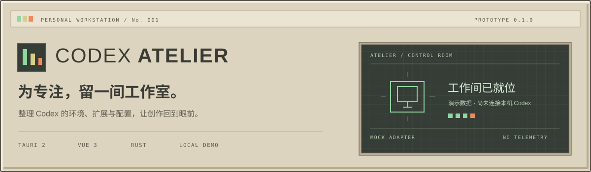

**Codex 的独立伴侣工作站** · `v0.1.0` 交互原型

把复杂留给工作台，把专注留给你。

<p>
  
  
  
  
</p>

<p>
  <a href="#start">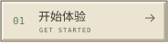</a>
  <a href="#preview">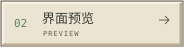</a>
  <a href="#roadmap">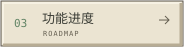</a>
  <a href="#development">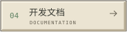</a>
</p>

</div>

> [!IMPORTANT]
> 当前主工作台、MCP/Skills 示例、诊断和备份仍为**演示数据**。新增「行为插件」页已接入本机 Ponytail / Stop That Shit 的固定版本安装、加载开关与回退；Hook 信任与会话实际效果仍需在 Codex 中确认。

<a id="about"></a>

## 简介


模型、Provider、MCP、Skills、会话、配置……随着 Codex 工作流逐渐丰富，环境管理也需要一个清楚、顺手的位置。

**Codex Atelier** 希望把这些外置能力放进同一间工作室：看清当前环境，整理扩展，理解配置变化，并在每次调整之前保留退路。它是独立伴侣工具，Codex 继续负责聊天与 Agent 执行。

- **一个有主次的工作台**：环境状态、当前连接、扩展概况与诊断摘要集中呈现，先看到值得关注的事。
- **一套有触感的界面**：米灰机壳、奶油面板、下沉仪表屏与薄荷绿键帽，让桌面工具也值得细看。
- **能亲手体验的原型**：搜索、筛选、详情、开关、弹窗和通知都可以操作，每处演示都有明确标识。
- **为真实接入留好边界**：页面与数据适配器分离，未来的配置变更需要经过预览、备份、确认与校验。

这是独立项目，与 OpenAI 无官方隶属关系。

<a id="preview"></a>

## 界面预览


### 行为插件 · 真实本机开关

在独立的「行为插件」页安装 Ponytail 5.3.2 与 Stop That Shit 0.2.5，并一键启停插件加载。安装默认停用，写入后读回验证；可回退上次切换，外部变更时停止覆盖。浏览器预览禁用真实操作。详见[行为插件使用与边界](docs/behavior-plugins.md)。

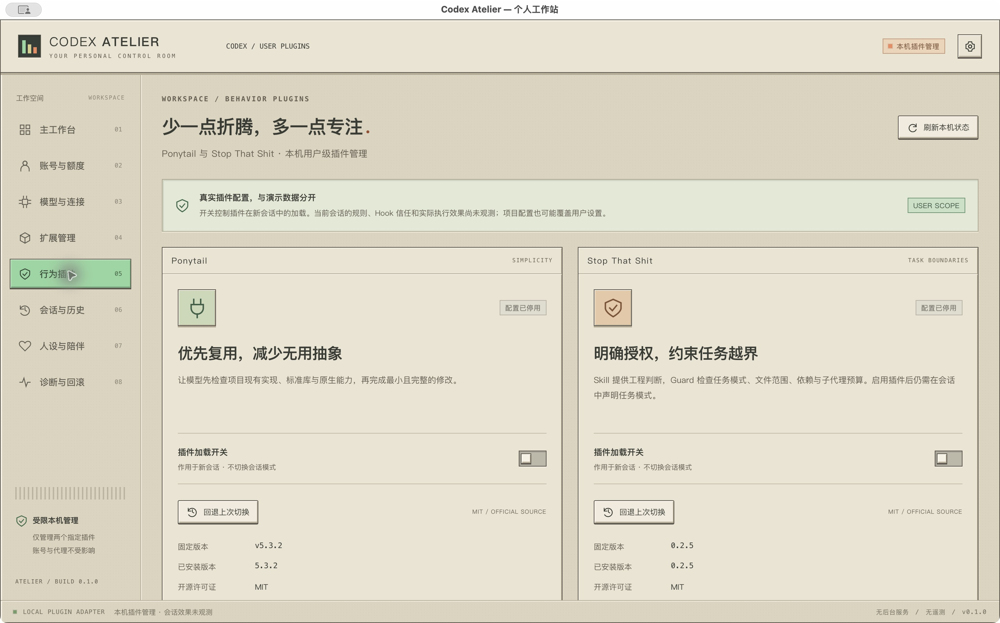

### 主工作台

深色仪表屏是视觉中心，连接与扩展紧随其后，诊断建议和快捷操作留在侧手边。截图中的状态全部来自 Mock adapter。

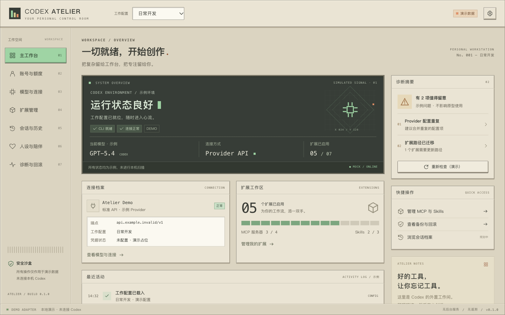

<details>
<summary><strong>扩展管理 · MCP 与 Skills</strong></summary>

按分类、关键词和启用状态查找扩展，在详情中查看示例工具与权限声明。启用或停用只改变本次运行的演示状态。

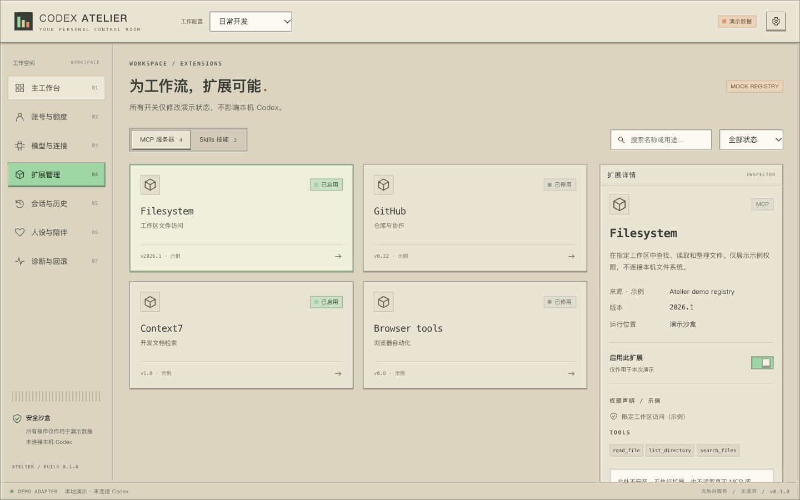

</details>

<details>
<summary><strong>诊断与回滚 · 从问题到变更预览</strong></summary>

查看分类检查、问题说明和风险，再进入演示差异预览。修复与恢复均需明确确认，完成后只显示模拟通知。

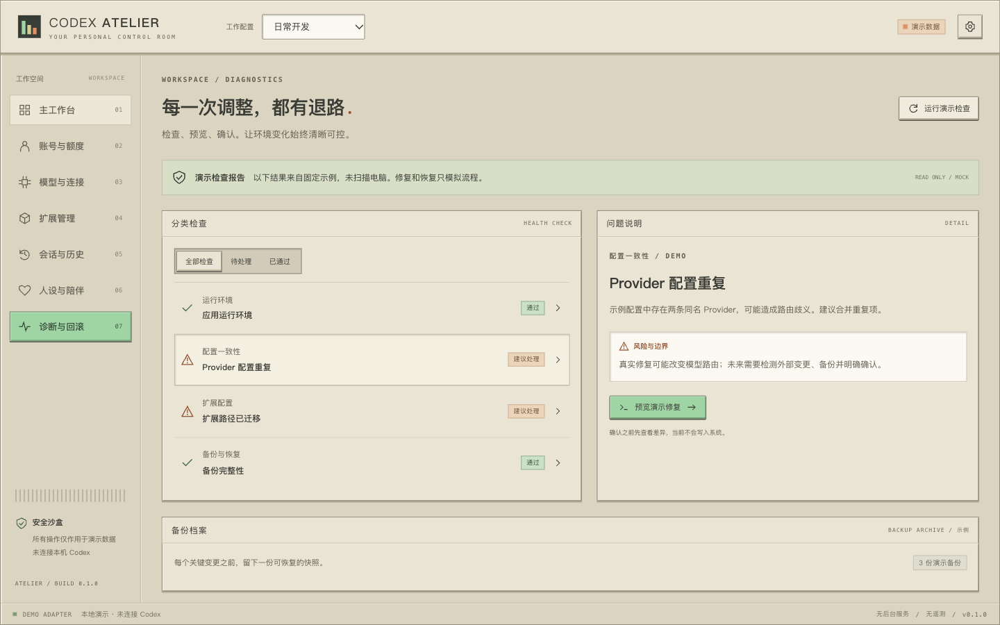

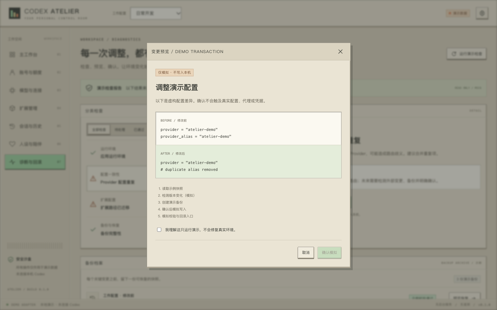

</details>

<details>
<summary><strong>原生窗口与较窄桌面窗口</strong></summary>

macOS Tauri 原生窗口已实际启动并验证。前端在 1440×900、1280×800、960×700 下检查过横向溢出；较小窗口使用内容滚动，保留桌面导航。

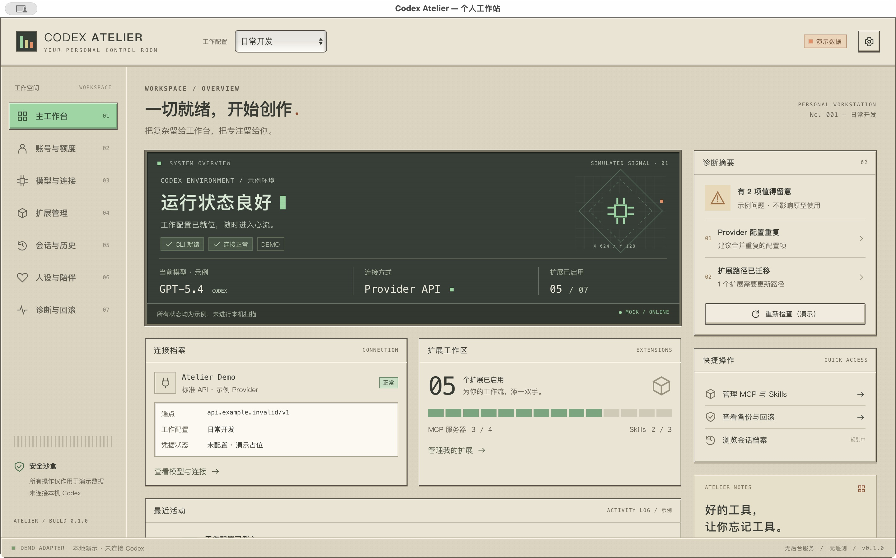

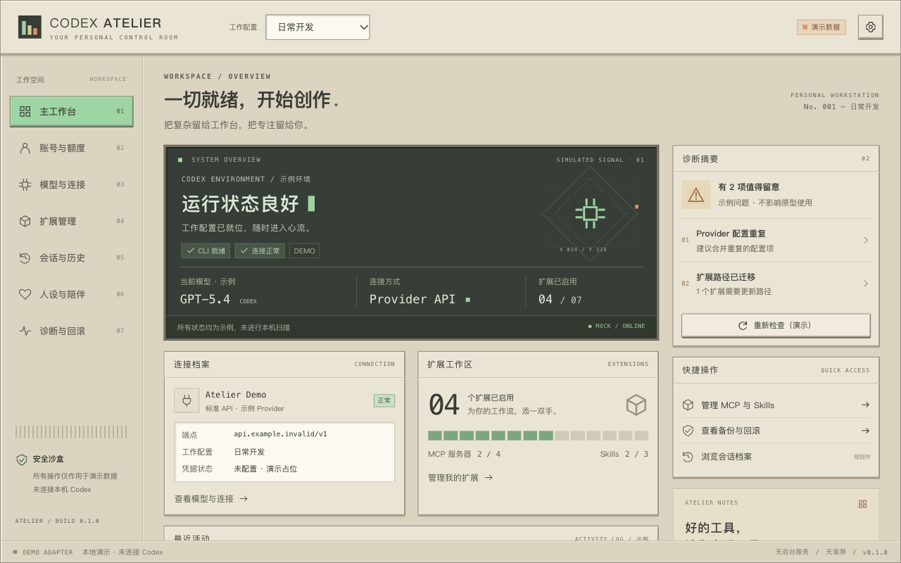

</details>

<a id="start"></a>

## 开始体验


当前通过源码运行。仓库包含前端与 Rust 锁文件；本地 macOS 调试包已验证，尚未提供正式签名安装包。

### 准备环境

- **Node.js 22.12+**，项目初始化与验收使用 `24.16.0`。
- **pnpm 10**，仓库声明版本为 `10.28.0`。
- **稳定版 Rust 与 Cargo**，以及对应平台的 [Tauri 2 前置依赖](https://v2.tauri.app/start/prerequisites/)。macOS 需要 Xcode Command Line Tools。

### 启动桌面应用

```sh
git clone https://github.com/zixin947/codex-atelier.git
cd codex-atelier
pnpm install --frozen-lockfile
pnpm tauri dev
```

只想预览前端，可运行 `pnpm dev`，然后访问 `http://127.0.0.1:1420`。浏览器预览与桌面验证是两项独立的检查。

### 构建

```sh
pnpm build                            # 前端产物：dist/
pnpm tauri build --debug --bundles app # 已验证的 macOS 本地调试包
pnpm tauri build                      # 发布模式构建，尚未完成发布验收
```

macOS 调试包位于 `src-tauri/target/debug/bundle/macos/Codex Atelier.app`。该产物未签名、未公证；Windows/Linux 构建尚未验证。当前仓库的 bundle 配置面向 macOS `.app`。

<a id="roadmap"></a>

## 功能进度

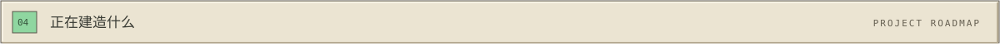

| 模块                  | 现在可以体验                                      | 真实能力进度                   |
| --------------------- | ------------------------------------------------- | ------------------------------ |
| 行为插件              | Ponytail / STS 固定版本安装、启停、状态读回、回退 | 本机管理已接入；会话效果未观测 |
| 主工作台              | 环境、连接、扩展与诊断概览；演示工作配置切换      | 数据全部为 Mock                |
| MCP 与 Skills         | 分类、搜索、筛选、详情、演示开关                  | 未安装或执行真实扩展           |
| 诊断与回滚            | 分类检查、风险说明、差异与恢复预览、确认流程      | 未扫描、备份或修改本机         |
| 账号与额度            | 规划状态页                                        | 尚未接入                       |
| 模型、Provider 与代理 | 规划状态页；工作台示例连接档案                    | 尚未接入                       |
| 会话与历史            | 规划状态页                                        | 尚未读取会话数据库             |
| 人设、长期记忆与桌宠  | 规划状态页；小型桌宠展示占位                      | 尚未实现                       |

**演示状态仅保存在内存中，刷新或重启即可复位。** 设置中可关闭演示交互，禁用扩展开关与模拟确认。深色调色板已预留，尚未开放主题切换。

<a id="development"></a>

## 开发与文档


采用 **Tauri 2 + Rust、Vue 3 + TypeScript + Vite、Vue Router 与 Pinia**。Vue 使用 Composition API 与 `script setup`，TypeScript 开启严格检查。

```text
src/
├── app/                 路由与应用状态
├── features/            工作台、扩展、诊断与规划页
├── shared/components/   图标、面板和弹窗
├── services/            可替换的 Mock adapter
├── types/               服务与配置事务契约
└── styles/
    └── tokens/          颜色、字体、间距、材质、尺寸与动效
src-tauri/               Rust 窗口与受限插件管理接口
tests/                   关键原型交互测试
```

| 资料                                    | 内容                                 |
| --------------------------------------- | ------------------------------------ |
| [设计决策](docs/design.md)              | 视觉方向、原型取舍、性能与维护假设   |
| [验收记录](docs/verification.md)        | 已执行的检查、原生验证与未验证项     |
| [设计令牌](src/styles/tokens/theme.css) | 机壳、面板、屏幕、字体和控件基础规范 |
| [Mock 服务](src/services/mock.ts)       | 示例扩展、检查、备份和变更预览       |
| [事务契约](src/types/atelier.ts)        | 未来真实配置修改必须保留的流程边界   |

### 验证命令

```sh
pnpm typecheck
pnpm test
pnpm build
pnpm format:check
cargo check --manifest-path src-tauri/Cargo.toml
cargo fmt --manifest-path src-tauri/Cargo.toml --check
```

项目初始化验收中，6 项交互测试、类型检查、前端构建、格式检查、Rust 检查及 macOS 调试打包均通过。这里记录的是已执行的本地验收结果，并非持续集成状态；完整限制见[验收记录](docs/verification.md)。

欢迎通过 [Issues](https://github.com/zixin947/codex-atelier/issues) 提交视觉建议、交互问题与功能讨论。反馈界面问题时，请附窗口尺寸、复现步骤和截图，并移除私人数据。

<a id="boundaries"></a>

## 设计与安全边界


**先看清，再调整；每一步，都应该能说明白。**

当前应用没有遥测、自动登录、凭据验证或后台常驻服务。行为插件页通过官方 Codex 接口读取插件状态、写入两个插件的启用字段；不会主动读取 `auth.json`、系统钥匙串或会话数据库，不接管系统代理、LaunchAgent、人设与记忆目录。

Rust 端新增四个只面向 Ponytail / STS 的受限管理命令，通过 Codex 官方配置接口管理插件启用字段，不暴露任意 shell 执行接口。Tauri capabilities 权限列表为空，资源与连接受 CSP 约束。

除行为插件启用字段外，其他配置接管预留以下事务边界，**目前只有接口定义，没有生产实现**：

```text
读取现状 → 检测外部变更 → 预览差异 → 备份
                                     ↓
                       明确确认 → 写入 → 校验
                                         ↓
                                      必要时回滚
```

预览中的路径、配置片段和版本号为示例，不代表真实 Codex 配置格式或兼容性承诺。

<a id="acknowledgements"></a>

## 灵感与致谢


感谢 [MaiBot](https://github.com/Mai-with-u/MaiBot) 的 millennium「千禧主题」带来的视觉灵感，以及其 README 的展示组织方式。Atelier 借鉴米色机壳、下沉屏幕与键帽的视觉语言，独立实现界面、封面、图标和 README 素材；没有复制上游 Dashboard 代码、角色、品牌或整套素材。

本项目使用的框架与工具包括 [Tauri](https://v2.tauri.app/)、[Vue](https://vuejs.org/)、[Vite](https://vite.dev/) 与 [Pinia](https://pinia.vuejs.org/)。第三方依赖遵循各自许可证。仓库目前尚未指定项目许可证。

<div align="center">

**MAKE ROOM FOR IDEAS.**

一间安静的工作室，一套清楚的工作流。

[回到顶部](#codex-atelier)

</div>
