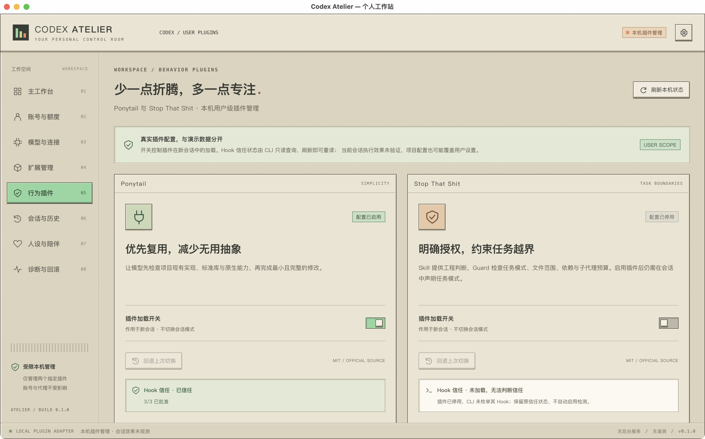
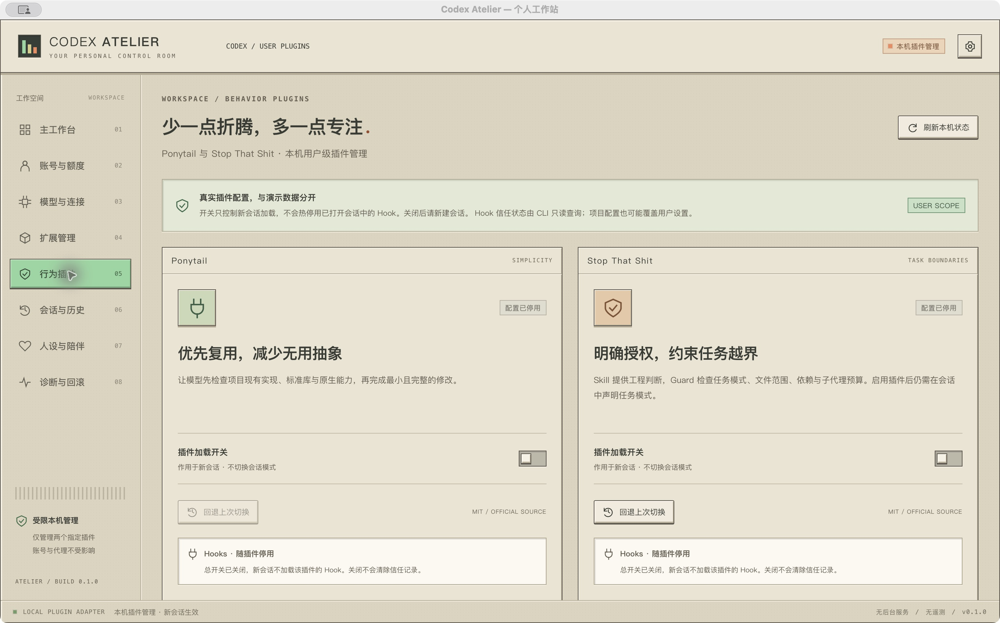
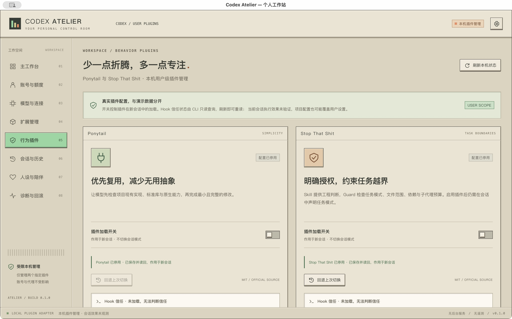

# 行为插件：Ponytail 与 Stop That Shit

Atelier 的「行为插件」页是实际本机管理功能，与其他页面的 Mock 开关独立。浏览器仅预览界面，不伪造本机安装状态或提供可操作的真实开关。



## 使用

1. 打开 Tauri 桌面应用，进入侧栏「行为插件」。需要本机 Codex CLI 与 Git。
2. 点击「安装固定版本」，查看来源及版本，再安装。新安装默认停用。
3. 点击对应加载开关。界面仅在 Codex 写入并读回有效状态后显示已启用/停用。
4. 点击「刷新本机状态」，读取 CLI 发现的 Hook 信任状态。有待信任或定义变化时，在 CLI 的 `/hooks` 中按宿主提示自行审阅、信任当前定义，再回到 Atelier 刷新。已信任不需要重复授权。
5. 如需当前会话热重载，由你在「连接 Desktop」中完成首次桥接启动，然后继续原有聊天。未连接时仍只影响新会话。关闭不会删除已经注入的规则，也不会向聊天发送命令。详见 [Desktop 桥接](desktop-bridge.md)。

Ponytail 的 lite/full/ultra 与 STS 的 review/change/watch/off 是插件自己的会话模式。本页开关管理**插件是否加载**，没有替代会话模式选择。STS 插件启用后仍需要明确任务指令才能进入 Guard 模式。

## Hook 信任只读检测

使用本机 Codex app-server 的 `hooks/list`，只请求 CLI 用户目录。按完整 `pluginId` 匹配两个受管插件，使用宿主返回的 `trustStatus`；不自行计算信任哈希，不读取或写入信任存储，不启动会话或运行 Hook。

| 状态     | 判断依据与显示                                                                 |
| -------- | ------------------------------------------------------------------------------ |
| 已信任   | 已枚举 Hook 全部为 `trusted` 或 `managed`；显示批准数、策略信任数和单独停用数  |
| 待审阅   | 存在 `untrusted` 或 `modified`；显示待信任与定义变化的数量                     |
| 未加载   | 没有枚举到该来源的 Hook；不能据此判断已信任或未信任，停用时不自动启用来检测    |
| 无法读取 | 接口失败、不支持、字段未知、发现不完整或来源重复；保留插件加载开关的独立可用性 |

这是 CLI 用户目录的发现结果，不包括具体项目覆盖，也不代表 Codex Desktop 当前会话。批准状态不证明 Hook 已执行。浏览器只显示无法读取，不生成演示信任结果。

已补充[实际脚本执行测试](hook-execution-verification.md)：CLI 与当前桌面内置引擎中，关闭后的旧会话仍执行 Hook，新会话不再执行。该结果针对未桥接的旧路径。新版对已连接的桥接宿主执行热重载，等待确认后显示会话覆盖数；真实 Desktop 的首次接入和验收由用户完成。

界面加载状态跟随主开关：关闭时显示“Hooks · 随插件停用”，新会话不加载该插件的 Hook；开启时显示“Hooks · 随插件加载”，并展示实际信任结果。主开关不会清除信任记录，也不会重新启用被用户单独禁用的 Hook。加载开关与信任批准仍是两个独立条件。

该联动已通过前端开关往返与单条停用保留测试；15 项前端测试、类型检查、构建、格式检查和 macOS 打包通过。原生窗口验证两个主开关仍关闭，两个 Hook 面板同步显示随插件停用，本次没有写入或重新启用本机插件。



采用官方只读发现接口，避免直接解析信任文件；停用时保留未知，避免临时启用或改写权限来探测。这些边界沿用原插件管理接口，不新增授权操作。

## 固定来源

| 插件           | 官方仓库                | 固定版本 | 固定提交                                 |
| -------------- | ----------------------- | -------- | ---------------------------------------- |
| Ponytail       | DietrichGebert/ponytail | v5.3.2   | 16352ac229eb08a9598dcae48fe9f2b342567d86 |
| Stop That Shit | lennney/stop-that-shit  | 0.2.5    | 8bc1ac558167121e7f28d9fb0bec05c039952206 |

来源保存在 `integrations/behavior-plugins.json`。安装下载官方 GitHub 源码至 Atelier 应用数据目录，检查 Git 提交、工作树与插件声明，再通过 Codex CLI 注册 `atelier-companions` 本地市场并安装。下载仓库中保留上游 MIT 许可证；上游实现没有复制进 Atelier 源码，也没有重新包装成自己的规则引擎。

已有官方市场安装时优先管理它，不强制重装或降级；同时存在官方与 Atelier 来源时禁用切换，要求用户在 Codex 中保留一个来源，以免同名规则重复加载。其他市场中名字相似的插件不在管理范围内。

## 写入与回退

- 只暴露四个受限 Tauri 命令：状态、安装、启停、回退。插件参数是固定枚举；不接收 shell、任意命令、任意仓库或文件路径。
- Codex 可执行文件从 PATH、常见 Homebrew 路径或 nvm 安装中发现，Finder 启动时补齐对应 Node 的 PATH。
- 状态使用带 `--marketplace` 的 `codex plugin list --json`，只查询 `atelier-companions`、`ponytail`、`stop-that-shit` 三个受管来源，每次查询最多 8 秒；不枚举无关远程市场。配置版本使用短时 stdio app-server 的 `config/read`。只向前端返回这两个插件的状态、版本与 Hook 明细，不返回完整配置内容。
- 启停通过官方 `config/value/write` 写入单个 `plugins."<id>".enabled`。携带配置版本令牌；过期状态停止写入，不覆盖外部变更。
- 写入前保存原启用值和官方配置版本；成功后保存写入版本。回退仅还原该布尔值，不复制整份配置或凭据。记录存放应用数据目录，macOS 新文件权限为 0600。
- 回退仅在配置版本和插件来源仍匹配时可用；有后续外部变更时，刷新并显式切换，不覆盖旧快照。
- Codex 用户级配置可能被项目或管理策略覆盖；写入返回 `okOverridden` 或读回不匹配会显示错误，不能冒充会话生效。
- 每次操作结束会回收短时子进程；没有常驻 daemon 或 WebSocket 监听。下载需要 GitHub 网络，启停不请求模型。

Atelier 不主动读取 auth.json、钥匙串或会话数据库，不接管 Provider、代理、LaunchAgent、人设和记忆。Codex 官方子进程按其自身机制加载必要配置；Atelier 不展示、复制或记录其中的凭据。这里授权范围由用户本轮要求扩展到两个插件的安装与启用配置，其他模块仍保留演示边界。

## 验证

```sh
pnpm test
pnpm build
cargo test --manifest-path src-tauri/Cargo.toml
cargo test --manifest-path src-tauri/Cargo.toml -- --include-ignored
```

最后一条包含真实 Codex CLI 的隔离测试：使用临时 CODEX_HOME、本地测试插件与未信任的测试 Hook，检查只读信任发现、停用后未加载、两个插件的状态读回、切换、回退、过期版本拒绝、无关配置和注释保留。重复读取后配置内容不变；不会使用真实账号、运行模型或信任 Hook。

当前支持验收的宿主是 macOS + Codex CLI 0.164.0。Windows/Linux 可执行文件定位、其他 CLI 版本、具体项目覆盖、Codex Desktop 中的加载及真实模型任务行为尚未验收。

## 参考

- [Codex CLI 插件管理](https://learn.chatgpt.com/docs/cli/reference)
- [Codex 配置接口](https://learn.chatgpt.com/docs/app-server)
- [Codex Hook 信任](https://learn.chatgpt.com/docs/hooks)
- [Ponytail](https://github.com/DietrichGebert/ponytail)
- [Stop That Shit](https://github.com/lennney/stop-that-shit)

## 2026-10-26 实际验收

- 前端：11 项测试通过，覆盖原有原型与新增真实插件页；类型检查、前端构建与格式检查通过。
- Rust：4 项测试通过（含真实 Codex CLI 的隔离配置测试），Rust 检查和格式检查通过。
- macOS 原生窗口：通过页面安装了两个固定版本，Ponytail 5.3.2 与 STS 0.2.5 的安装版本已由 Codex CLI 读回。
- 原生操作：Ponytail 停用→启用→回退停用；STS 停用→启用→停用，均观察到读回状态变化。最后两者均停用。
- 浏览器：1440×900、1280×800、960×700 无横向溢出；真实操作全部 disabled，未伪造已安装状态。
- 视觉修正：将加载开关与主要操作前移到描述下方，减少寻找开关的滚动距离。
- `pnpm tauri build --debug --bundles app` 通过，生成可启动的 macOS `.app`；本地调试构建尚未签名、公证或验证跨机器分发。
- 未确认 Hook 信任、未启动模型验证插件实际行为；没有声称当前聊天已受这些规则影响。

## 2026-10-27 Hook 检测验收

- 前端 13 项测试通过，包含刷新后信任状态变化、定义变化提示、未加载与读取失败；类型检查、构建、格式检查通过。
- Rust 8 项测试通过，包含准确来源匹配、混合状态、未知状态与接口失败、不完整发现、真实 CLI 隔离读取及配置不变；检查和格式检查通过。
- macOS 调试 `.app` 打包通过，已重新打开原生窗口并点击刷新：Ponytail 返回 3/3 已批准，STS 停用且未枚举；保持用户原有启用值与信任决定。
- 浏览器 1440×900、1280×800、960×700 无横向溢出，真实操作禁用，Hook 显示无法读取；截图已更新。
- 将信任结果放在开关区域后、版本信息前，以状态色和数量替换固定警告。
- 未运行模型任务、修改 Hook 信任或验证 Desktop 会话；本机未产生真实的定义变化状态，该分支通过协议夹具验证。

## 2026-10-27 关闭操作排查与修正

- 原生复现：旧版点击关闭后仍保持开启，最终返回“Codex 配置已被外部修改”。冲突保护阻止了写入；错误位于页面顶部，滚动到开关处时容易漏看。
- 同时复现全市场 `plugin list --json` 超时，而三个受管来源的定向查询均可快速返回。关闭前不再依赖无关市场，保留原有版本冲突保护，不自动覆盖外部修改。
- 开关旁新增操作中状态、明确的“已停用 · 已保存并读回”结果，以及失败原因和刷新入口。不会先显示关闭再等待后台写入。
- 前端 15 项测试通过，新增开启→关闭等待读回、失败保持开启、就地刷新恢复与重新挂载读回停用状态的覆盖。
- Rust 9 项测试通过。隔离 CLI 测试加入拒绝全市场查询的包装器，定向查询、关闭两者、用新宿主进程重读保持关闭，以及配置冲突拒绝均通过。
- 新版 macOS 原生窗口中依次关闭 Ponytail 和 STS，两个开关均返回已停用、已保存并读回；退出并重新打开 Atelier 后仍然关闭。独立 Codex 配置接口再次确认两个 `enabled` 均为 `false`，`hooks/list` 未枚举这两个插件的 Hook。
- 停用只改变受管插件的加载字段，不撤销 Hook 信任；此前已加载规则的会话仍需另行结束或新建，不能用配置读回冒充当前聊天已卸载。


