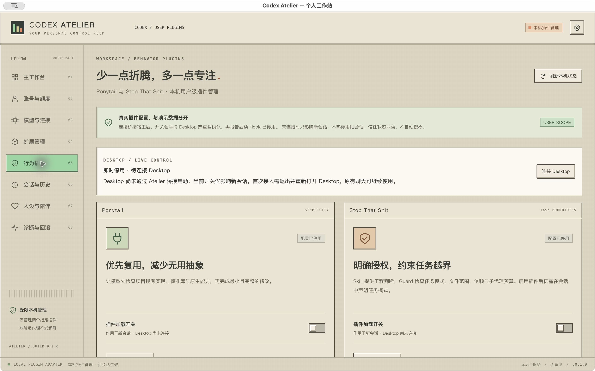

# Desktop 本地桥接

实现状态：桥接、宿主发现、开关热重载、回执、失败提示和原生启动入口已实现。真实 Desktop **尚未接入，也未完成真实客户端验收**；按用户要求，这一步由用户执行。

## 由你首次接入

1. 打开新版 Atelier，进入「行为插件」→「连接 Desktop」，查看说明。
2. 自行退出 Codex Desktop，再点击「已退出 Desktop，启动桥接」。如果 Desktop 仍在运行，Atelier 会拒绝启动，不会替你关闭它。
3. 在启动的 Desktop 中继续原有聊天，然后在 Atelier 刷新。连接区应显示宿主数与已加载会话数。
4. 切换 Ponytail 或 Stop That Shit。成功时，开关旁应显示「已保存并读回」及「Desktop 宿主已确认热重载」与覆盖的会话数。后续切换不需要新建会话或重启 Desktop。

macOS 调试包：`src-tauri/target/debug/bundle/macos/Codex Atelier.app`。当前启动入口适配 `/Applications/ChatGPT.app`；其他安装路径、Windows/Linux 客户端尚未支持。安装包未签名、未公证。

## 生效范围

- 仅覆盖通过此桥接启动、与 Atelier 使用同一个 `CODEX_HOME` 的宿主。普通启动的 Desktop、其他 CLI 与其他独立宿主不在此范围。
- 首次启动后继续原有聊天即可。已经运行的 stdio 宿主无法被追溯附加这个 socket；本功能不会接管它的内部管道。
- 未连接时保留原先的用户配置开关，只影响后续新会话。发现已有桥接记录但连接异常时，停止写入并显示错误，不悄悄退回普通写盘。
- 热重载回执证明宿主完成了重载请求，不等于逐条 Hook 执行审计。项目级配置、策略覆盖或其他插件来源仍可能改变效果；不会自动改写这些设置。
- 停用针对后续触发；已经运行的 Hook、已经注入的上下文不能撤回。不清除信任记录，也不自动信任任何 Hook。
- 开启会重新加载宿主允许的插件定义，仍受各条 Hook 自身的启用与信任条件约束。

## 实现与边界

`desktop_bridge.rs` 让同一个 Atelier 可执行文件在专用环境变量启用时充当 CLI 传输桥接；通常启动仍运行 Tauri 界面。首次启动入口仅向新 Desktop 进程传入 `CODEX_CLI_PATH` 和本次桥接所需环境变量，没有全局设置环境变量，没有替换 Desktop 文件。

桥接保留 Desktop 原有启动参数与 JSON 消息，用它捆绑的原始 Codex 引擎提供 Unix socket。非 app-server 启动检查直接委托原始引擎；不开放任意 shell 执行的 Tauri 命令。Atelier 通过另一个本地 WebSocket 连接访问同一引擎，而不是向另起的无关 app-server 重载。

连接记录仅包含协议版本、引擎 PID 和 socket 路径，不保存聊天、配置全文、密钥或 Hook 信任哈希。目录权限为 `0700`，记录/socket 为 `0600`。连接时检查所有者、权限、Codex 私有 socket 目标、macOS 对端 PID、用户目录以及已加载会话清单。

切换仍使用官方 `expectedVersion` 检测冲突，只写两个受管插件之一的 `enabled`，通过 `config/batchWrite` 的 `reloadUserConfig=true` 请求所属宿主热重载。回退仍保留原布尔值与版本令牌，多宿主会分别请求重载；部分失败会报告未确认，不声称全部会话生效。

正常退出或收到退出信号时，桥接停止自己的引擎并回收连接记录。没有 LaunchAgent、登录项、TCP 监听、常驻 daemon 或遥测。异常强杀可能留下失效记录；发现后拒绝继续写入，不自动接管别的进程。

恢复普通启动：退出桥接启动的 Desktop，再从「应用程序」普通打开即可。此时没有改写 Desktop 安装文件或全局启动配置需要恢复。

参考：[OpenAI app-server 传输与配置接口](https://learn.chatgpt.com/docs/app-server)。

## 已有隔离验证与待验收项

以下是收到用户「你不要测试」指示前完成的隔离结果。后续停止运行测试，不操作真实 Desktop；收尾只做文档整理与编译打包。

使用本机 Desktop 内置引擎 `0.164.0-alpha.11.1` 与原生 CLI 引擎 `0.164.0`，通过新桥接启动临时宿主，调用 Atelier **实际使用的 Rust 切换路径**，执行固定版本 Ponytail / STS 原始脚本。每套结果均为：

| 场景                                 | 结果                                          |
| ------------------------------------ | --------------------------------------------- |
| 首回合开启对照                       | 4 次 Hook 完成                                |
| Rust 开关关闭后继续同一会话          | 0 次 Hook                                     |
| 重新开启后继续同一会话               | 3 次 Hook 完成                                |
| 进行中的一轮，在两次实际命令之间关闭 | 关闭前 3 次；关闭后 0 次 Hook，第二次命令成功 |
| 关闭后结束会话                       | 0 次 SessionEnd Hook                          |
| 关闭后新建会话                       | 0 次 Hook                                     |
| 外部配置变更后使用旧版本操作         | 拒绝写入                                      |
| 桥接退出后的失效记录                 | 拒绝写入，配置版本保持不变                    |

每套包含 6 次真正执行且退出码为 0 的 `true` 命令。模型响应来自本地固定 Responses fixture，不使用真实模型或凭据。证据见 [执行记录](evidence/desktop-bridge-acceptance-20261027.json)，复现入口为 `scripts/verify-hook-execution.py` 的 `--bridge-binary` 和 `--bridge-control-test` 参数。CLI 模式需传原生引擎路径；npm 的 Node 启动器不是 socket 对端进程，会被 PID 校验拒绝。

此前前端 18 项测试、Rust 9 项常规测试、Clippy、构建与 macOS 打包通过。隔离验收另外执行了对应 Rust 控制测试。原生窗口检查过未连接状态及「Desktop 仍运行时拒绝启动」；没有重启、改写或切换真实 Desktop 的启动方式。

**待你验收：** 实际 Desktop 客户端启动兼容性、原有聊天继续使用、真实聊天中开关对后续 Hook 的影响、项目覆盖、多宿主部分失败、真实审批/交互请求及异常退出恢复。没有把隔离引擎测试当作真实客户端端到端验收。
