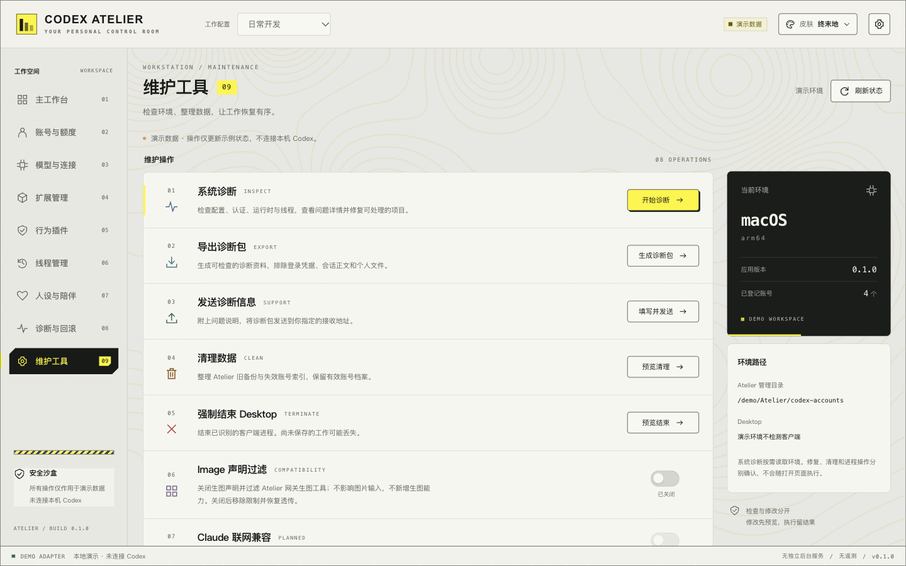
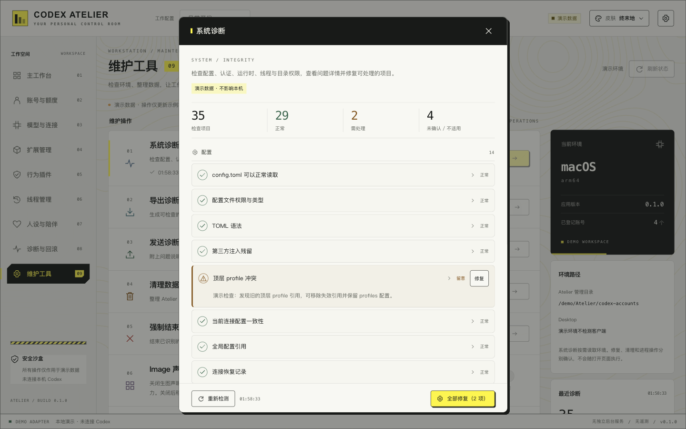
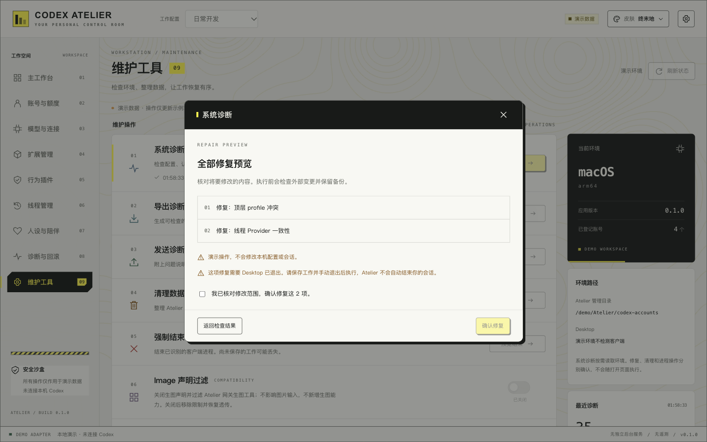

# 维护工具

`/maintenance` 以本机 AiMaMi **1.2.7 安装版**的维护页和诊断流程为参考，独立使用 Vue 3 / Rust 实现，保留 Atelier 的终末地与千禧主题。原有“诊断与回滚”演示页不受影响。

本栏目已对齐维护入口和诊断交互，但不是完整上游 Rust 源码的移植。安装版代码与公开仓库存在差异；这里明确区分实际实现、演示适配器及尚未复刻的后端行为。

## 维护入口

| 入口             | 原生实现                                                                                                                      |
| ---------------- | ----------------------------------------------------------------------------------------------------------------------------- |
| 系统诊断         | 打开自动检测、35 个检查 ID、四类分组、详情、单项/全部修复预览、确认、日志与复检                                               |
| 导出诊断包       | 原生保存对话框，生成 ZIP，原子保存并读回校验；取消不显示成功                                                                  |
| 发送诊断信息     | 用户指定接收地址并确认后发送 multipart；无默认 AiMaMi 接收端，无自动上传                                                      |
| 清理数据         | 预览并清理 Atelier 自身旧注册表备份和失效账号索引                                                                             |
| 强制结束 Desktop | 确认后仅结束识别到的 Codex / ChatGPT 应用包内进程；核对 PID 与可执行路径，不自动重启                                          |
| Image 声明过滤   | 预览后设置 Codex `[features] image_generation = false`，并在下一次 Atelier 网关请求中过滤生图工具；关闭移除声明限制并恢复透传 |
| Claude 联网兼容  | 和参考维护页一样禁用；不是已经实现的 Anthropic 联网功能                                                                       |
| 重启 Desktop     | 确认后正常退出并重启；退出失败不会自动强杀                                                                                    |
| 重建账号注册表   | 保留为次级入口；从 Atelier 保存的账号档案重建自身列表并保留可匹配的元信息                                                     |

Image 声明过滤覆盖顶层 `tools` 和 `input.additional_tools` 中的 `image_generation` / `namespace:image_gen`，不删除 `input_image` 或同名普通函数，不新增生图能力。客户端何时重新读取配置由 Desktop 决定；网关侧偏好逐请求读取，无需重启网关。

## 诊断与修复

检查项覆盖配置、认证、本地网关、模型目录、线程、项目状态、目录权限与数据库布局。每项返回 `id / group / status / label / detail / fixable`。`unknown`、`skipped`、异常与正常单独显示，缺少证据不会计为通过。

检查源配置和会话时不创建可写性探针、不触发恢复或修复。SQLite 通过受限临时副本读取主库和 WAL；检测不打开原库创建 SHM。快照不稳定、损坏或超过大小/数量限制时显示覆盖不足。诊断只向 Atelier 自身保存允许字段的状态摘要，原始配置、凭据和正文不回传界面。

已实现自动修复的 10 类 ID（实际是否可修以当前条件为准）：

| 检查 ID                                            | 修复行为                                                                                                 |
| -------------------------------------------------- | -------------------------------------------------------------------------------------------------------- |
| `config_profile_conflict`                          | 移除指向不存在配置档的顶层 profile；保留有效配置档与注释                                                 |
| `config_global_validity`                           | 移除未定义的 Provider 选择，回到内置 openai；不删除其他 Provider 定义                                    |
| `config_stale` / `router_http_contract`            | 仅对 Atelier 受管 Provider 校正网关端口、`/v1` 与 HTTP 请求契约，不接管其他连接                          |
| `thread_provider_consistency`                      | 同步修改线程索引和身份匹配的会话元数据                                                                   |
| `db_orphan_providers` / `rollout_orphan_providers` | 将失效的 Atelier 受管 Provider 对齐到当前有效 Provider                                                   |
| `thread_missing_rollouts`                          | 仅恢复到实际存在且身份唯一匹配的会话文件，不生成假记录                                                   |
| `thread_response_item_ids`                         | 按已核对的上游规则修复 legacy `ct_` / `fc_` / `ts_` 工具调用 ID；保留非目标字节及 `call_id`              |
| `project_state_integrity`                          | 用真实线程 cwd 恢复空项目入口、排序和映射；空 cwd 只从身份匹配的会话元数据回填，保留已有字段和无项目排除 |

涉及历史文件字节重写时，会识别原生分页/位置锚点并拒绝不兼容改写。压缩 `.jsonl.zst` 保持压缩。文件与数据库修改使用预览 ticket、固定写锁、外部变化检查、备份及读回；事务失败恢复本次文件变更，回退不会覆盖后续外部修改。需要关闭客户端的修复会明确要求用户退出，不自动结束客户端。

### 尚未原样复刻的行为

- 任意损坏 TOML 的自动重建、第三方残留的自动删除、认证文件自动恢复。
- 上游私有 Router 接管/恢复日志、旧迁移 manifest、缓存和钥匙串恢复。这些不属于 Atelier 现有存储模型，不伪造对应状态。
- 官方模型目录联网刷新及自动目录修复、异常基础指令的自动重写、双目录线程数据库的自动合并/搬迁。
- 部分检查采用可验证的本地结构信息；不把离线认证检查当作登录有效性验证，不把文件权限元数据当作实际写入成功。

因此“35 项检查”不等于“35 项都支持一键修复”，也不等于每个检查的内部策略已与上游完全相同。无法自动处理的项目显示原因，修复按钮不伪装可用。

## 诊断包与接收协议

ZIP 仅包含应用版本/平台、Image 偏好、最近一次检查的 ID/状态/时间及说明。排除凭据、账号标识、个人路径、环境变量、会话正文、原始日志和问题详情。导出不会自动再扫描。

接收端由用户填写 HTTPS 地址（本机回环允许 HTTP），不允许 URL 内凭据、查询和片段。确认发送后使用 multipart 字段：`requestId`、`userNote`、`bundle`（ZIP）。HTTP 成功才显示接受回执；如 JSON 返回 `reportId` 或 `id` 则展示该编号，否则明确显示本地追踪编号。用户填写的问题说明会随包发送。接收端的保存期限由该接收端决定，Atelier 不声称或控制 30 天保留策略。

原生保存使用 [Tauri 2 Dialog](https://v2.tauri.app/plugin/dialog/)；浏览器独立 Mock 使用生成的演示 ZIP 和浏览器下载。

## 运行和边界

```sh
pnpm install
pnpm tauri dev
pnpm build
pnpm tauri build --bundles app
```

浏览器开发：`pnpm dev`，打开 `/#/maintenance`。浏览器的检查、修复、开关和发送全部是独立演示适配器，不会调用真实 Codex。原生模式由受限 Tauri 命令实现，不暴露任意 Shell 或任意写文件接口。

诊断/修复备份位于 Atelier 应用数据目录的 `maintenance` 下。回滚文件包含原配置/会话片段，应当按敏感本地备份保管，不会加入诊断包。栏目暂不提供通用备份恢复界面，可根据每次返回的备份清单手工恢复。

## 验证与截图

本轮使用临时目录、合成认证/线程数据、模拟进程以及本机测试 HTTP 服务。未执行对真实 Codex 的诊断、修复、强制结束或重启；真实 Desktop 验收留给用户。浏览器截图与交互验证不等于原生运行验收。

具体命令、结果和未验证项见 [本轮验证记录](maintenance-verification.md)。







## 2026-11-10：按 AiMaMi 1.2.7 原版重做页面与系统诊断

维护页与系统诊断弹窗改为按安装版原版排版复刻，样式用项目自有 CSS 写就并跟随当前皮肤，没有引入 Tailwind。

- 维护页从带序号色块的卡片网格改为原版的单卡片 + 分隔行结构：18px 图标、14px 标题、12px 描述、右侧动作按钮或开关，九行顺序为系统诊断、调试日志、发送诊断信息、清理数据、重建注册表、强制关闭 Codex、Image 声明过滤、Claude 联网搜索、重启 Codex。
- 对话框宽度按原版 448px，含加载态、全部正常态、四组滚动列表、条目行与「修复」按钮、「全部修复（N 项）」、「修复结果」块。
- 交互改为原版语义：单项修复与全部修复都是一键执行，不再有用户可见的预览与勾选确认；预览、备份、读回校验仍由后端完成，只是不再呈现为步骤。重启 Codex 保留原版的二次确认弹窗。
- 目录写入检查不再占用独立入口，改为挂到 `codex_home_writable` 这一条目的修复动作上，仍使用独立票据。
- 智能路由切换期间按原版把每行文案替换为过渡说明并附「原始检测：」，此时不提供任何修复入口。

条目证据与文案来源见 [系统诊断条目矩阵](research/maintenance-parity-matrix.md)，二进制常量提取结果见 [证据目录](research/maintenance-evidence/)。

已按原版文案调整的条目：`config_access`、`config_toml_syntax`、`proxy_running`、`catalog_path_validity`、`catalog_integrity`、`official_catalog_freshness`、`codex_process_state`、`codex_home_writable`。

仍需逐函数裁定的部分：`router_postcondition` 的提交确认条件、`project_state_integrity` 的索引算法、`native_off_invalid_openai_thread_models` 的模型映射规则，以及各 `fix_*` 的前置条件。这些没有证据时不宣称已对齐。
