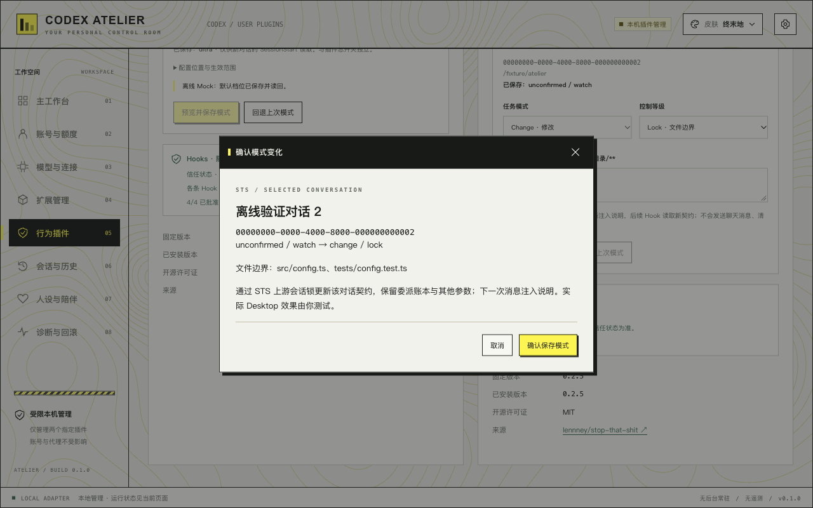

# 插件模式控制

已确认范围：Ponytail 管理新对话默认档位；STS 管理指定对话的任务模式与控制等级。真实 Desktop 由用户验收，本轮不切换真实模式、不发送测试消息或重启客户端。

## 决策

- Ponytail 使用上游 `config.json` 的 `defaultMode`（lite/full/ultra/off），保留其他字段。保存前检查版本，原子替换、备份并读回。独立的插件总开关不会自动开启。
- STS 上游没有全局默认模式。通过只读 app-server API 列出近期对话元信息，只提供已存在 STS 会话状态的目标，不读取聊天正文或数据库文件。
- STS 使用固定版本上游的 `parseContractPrompt`、`updateSession` 与会话锁，修改所选对话的契约，保留委派账本和其他控制字段。重置 `lastPromptContext`，让下一次用户消息重新注入模式说明。
- STS 的 guard/lock 要求明确任务模式；lock 要求非空文件边界。不会自动批准 Hook、启用插件、建立全局默认或代发模式指令。
- 每次保存明确预览目标和范围；冲突后要求刷新，不自动覆盖。回退同样检查写入后版本。
- 源码与状态路径由后端根据固定插件 ID 推导。Node 仅执行打包的受限适配器与经固定提交校验的上游模块；不暴露任意脚本、路径或 shell 接口。

## 生效边界

Ponytail 默认配置由其他宿主共享，且可能被 Desktop 的 `PONYTAIL_DEFAULT_MODE` / `XDG_CONFIG_HOME` 覆盖。Atelier 只能报告自身可见的环境与配置，不能把默认档位当作某条旧对话的实际档位。

STS 保存成功证明所选会话契约已更新。后续 Hook 每次读取它；任务说明在下一次用户消息注入。不能撤回已有上下文或正在执行的 Hook，也不能把插件的拒绝响应当作宿主最终已阻断的证明。

## 使用

1. 在「行为插件」安装对应固定版本。模式控制需要 Atelier 下载并校验的上游源码与一致的插件缓存，STS 还需要本机 Node.js；不会自动安装或升级环境。
2. Ponytail 选择默认档位，点击「预览并保存模式」后确认。插件关闭时也可预设，但不会自动开启。新对话的 SessionStart 读取该配置。
3. STS 开启并在目标新对话发送一条普通消息后，刷新对话列表。选择目标，再设置任务与控制等级；Lock 必须填写非空文件边界。确认窗再次展示目标完整 UUID 与变化。
4. 保存成功后发送下一条消息，检查模式说明和实际 Hook 行为。若对话正在运行，状态可能已变化；刷新后再明确保存，不自动覆盖或重试。
5. 「回退上次模式」只在保存后版本仍匹配时可用。STS 的后续 Hook 会更新状态，因此回退窗口可能很短。回退不恢复旧聊天上下文或账本。Ponytail 原本无 defaultMode 时回退会移除该字段，保留其余字段及配置文件。

近期清单只检查最近 100 条未归档的 app-server 对话，最多展示 32 条已有 STS 状态的对话。较旧目标可按完整 UUID 读取。`thread/list` 使用 `useStateDbOnly=true`，避免默认的会话文件扫描修补；单条核对用 `thread/read` 且 `includeTurns=false`。这不是对运行中 Desktop 宿主的绑定证明，也不代表真实 Hook 已执行。

备份保存在 Atelier 应用数据目录的 `plugin-modes/` 下，新文件权限为 0600。Ponytail 仅备份原默认字段；STS 仅备份所选契约，不复制提示词、聊天内容、凭据或委派账本。

## 验证边界

使用临时 HOME、CODEX_HOME、PLUGIN_DATA 和上游固定源码验证：Ponytail 实际 SessionStart 输出各档位；STS 实际 Hook 读取所选契约、输出新说明、做出对应允许/拒绝决定；另外核对冲突、回退、两会话隔离与账本保留。真实 Desktop 的选择、下一条消息和 Hook 执行留给用户。

## 2026-10-29 验证记录

复现命令（将上游源码路径替换为本机已校验目录）：

```sh
pnpm exec vitest run tests/plugin-modes.test.ts tests/plugins.test.ts
pnpm typecheck
pnpm build
ATELIER_MODE_TEST_SOURCE='/path/to/verified/marketplace' cargo test --manifest-path src-tauri/Cargo.toml plugin_modes -- --include-ignored --nocapture
```

- 前端 24 项通过，其中新增 8 项覆盖模式预览、确认后写入、键盘选择、目标锁定、回退、失败及不兼容状态。
- Rust 4 项通过，含原始 Ponytail SessionStart 的四档输出和实际 STS Hook 的五种任务模式、四级控制、下一条消息注入、Lock 内外路径、过期版本拒绝、备份失败不写入、回退、会话隔离和委派账本保留。测试没有执行实际工具写入或请求模型。
- 浏览器离线 Mock 检查 1440×900、1280×800、960×700，无横向溢出；验证确认前不写入、指定对话保存与回退、冲突保留旧状态、Escape 取消和焦点返回。根据截图收紧卡片介绍留白，修正终末地选中态。浏览器截图不是原生 Desktop 验收证据。
- 完整 `pnpm test` 共 53 项通过；`pnpm tauri build --bundles app` 生成 macOS release `.app`。`cargo fmt --check`、本次变更格式检查与 `git diff --check` 通过。原生模式页未操作，应用包未签名、公证或验证跨机器分发。
- 真实 Desktop 未操作、未重启，未切换真实插件模式，未发送测试消息；用户自行验收真实流程、环境覆盖与宿主对 Hook 拒绝响应的处理。



