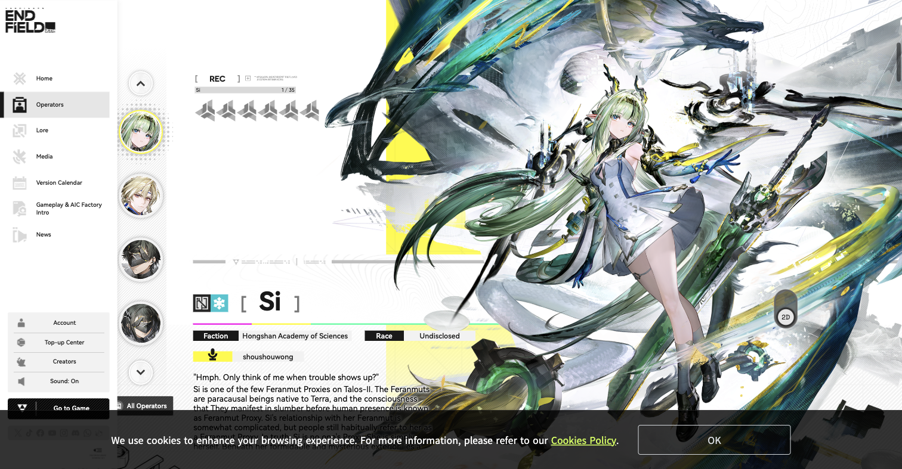
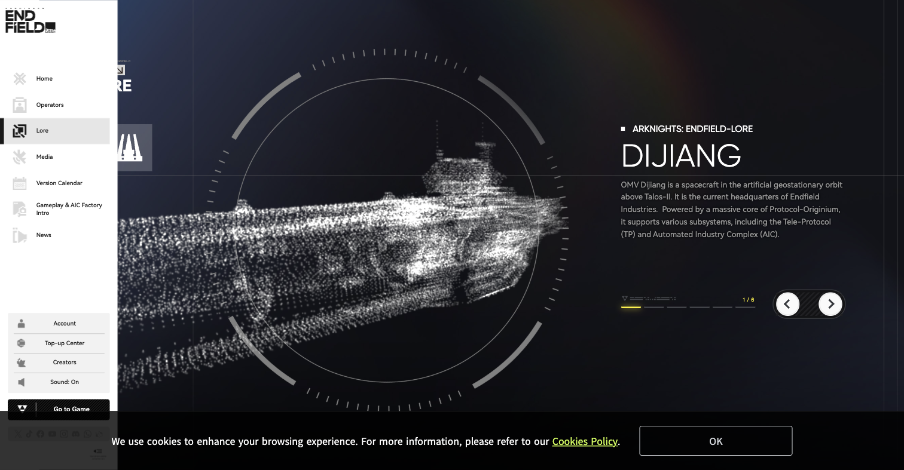

# 终末地 UI 参考资料

采集日期：2026-11-02。用于 Codex Atelier 后续视觉设计，覆盖官方网页、公开游戏界面样本、动效分析、组件库、主题、字体与图标线索。它是一次公开资料调查，不代表收齐游戏每个版本、每个菜单和每个交互状态。

最值得保留的特征是明显的信息主次、贴边的功能轨、精确的字形与数字、浅深表面的对比，以及与操作结果对应的短动效。黄色、切角和等高线只是其中一部分。官方界面同时使用直角、微圆角、圆形和胶囊，不能用“所有控件切角”代替设计。

本目录仅含研究文档、公开仓库元数据、官网计算样式记录与网页参考截图；没有修改应用代码、安装插件、引入字体或操作真实 Codex Desktop。参考截图不作为 Atelier 运行时素材。

## 证据与阅读方式

| 标记 | 含义                                           |
| ---- | ---------------------------------------------- |
| 实看 | 本次在浏览器打开并查看了实际画面               |
| 实测 | 本次从官方页面的 DOM 读取计算样式，见原始 JSON |
| 阅读 | 本次读取了正文、README 或具体源文件            |
| 索引 | 搜索或其他资料发现的入口；没有完成内容核验     |
| 建议 | 针对 Atelier 的设计判断，不是游戏官方规范      |

GitHub 的“元数据已核对”只表示仓库可访问、默认分支与许可证标识已查询，不表示审阅了整个项目。第三方自称“终末地设计系统”的项目均为非官方。

## 官方来源

| 来源                                                                       | 本次状态                                       | 适合研究什么                                                 |
| -------------------------------------------------------------------------- | ---------------------------------------------- | ------------------------------------------------------------ |
| [国际服官网](https://endfield.gryphline.com/en-us)                         | 实看、实测                                     | 当前版本主视觉、固定侧栏、下载坞、主次排版                   |
| [干员情报](https://endfield.gryphline.com/en-us#operator)                  | 实看、实测                                     | 人物与信息错位构图、头像轨、括号标题、成对标签、圆形翻页     |
| [世界观资料](https://endfield.gryphline.com/en-us#lore)                    | 实看                                           | 深色章节、点云主体、刻度圆环、文字区与分页的关系             |
| [玩法介绍](https://endfield.gryphline.com/en-us#gameplay)                  | 实看结构、实测                                 | 巨型字标、媒体区域、黄色侧签；本次媒体区域没有显示出视频内容 |
| [官网影像资料](https://endfield.gryphline.com/en-us/video)                 | 搜索索引                                       | 继续查找官方演示与版本视频                                   |
| [国服官网](https://endfield.hypergryph.com/)                               | 入口已核对；网页抓取超时                       | 中文标题与各章节；本次独立样式测量来自国际服官网             |
| [云终末地](https://endfield.hypergryph.com/cloud)                          | 已导航；文档加载完成但正文为空，未取得可用画面 | 待补工具化页面参考，不能拿第三方参数冒充本次实测             |
| [公测前瞻研发通讯](https://endfield.hypergryph.com/news/8564)              | 阅读，2026-01-17                               | 正式上线前的系统与界面变化；包括分类、推荐、地图提醒等       |
| [Beta Test II 研发通讯 02](https://endfield.gryphline.com/en-us/news/1340) | 阅读，测试期资料                               | 工业系统、批量操作、蓝图、地图层级及多平台交互的历史依据     |
| [官方 Gameplay Demo](https://www.youtube.com/watch?v=2h85NtIwduY)          | 搜索确认官方发布；未完整播放                   | 2022 年早期设计，只作演变对照                                |
| [PS5 Gameplay Demo](https://www.youtube.com/watch?v=2GjOGijE9fM)           | 索引，未完整播放                               | 手柄 HUD 与实机演示，不能当作当前 PC 菜单的精确规范          |

官网会随版本更换主视觉。当前首屏显示 Sanctuary of Ink，不能把它的角色、青绿、墨迹与金色当作全局系统色。

## 本次截图

截图保留网页原有布局与提示条。官网素材及游戏画面的权利属于对应权利人；站酷截图还包含作者页面。它们是研究参照，不是项目原创素材，也不随应用打包。

| 文件                                                    | 观察重点                                                                               |
| ------------------------------------------------------- | -------------------------------------------------------------------------------------- |
| [官网首屏](screenshots/official-home.png)               | 大面积白底、偏心角色构图、左侧图标轨、右下下载坞                                       |
| [官网干员页](screenshots/official-operators.png)        | 圆形头像列、方括号名称、信息标签与角色大图                                             |
| [官网世界观页](screenshots/official-lore.png)           | 深底、巨大点云图、环形刻度、独立正文与圆形翻页按钮                                     |
| [官网玩法页](screenshots/official-gameplay.png)         | 实心巨字、黄色竖签、框外章节标注；视频区域未加载                                       |
| [游戏 HUD 样本](screenshots/game-hud-zcool.png)         | 站酷文章所嵌实机 GIF 的一帧，四周信息停靠，中心留给场景                                |
| [装备与活动转场样本](screenshots/game-panels-zcool.png) | 同一文章内的动画中间帧，可见浅色资料界面与深色活动界面；不能用淡出帧判断最终文字对比度 |
| [活动页与行动按钮](screenshots/game-activity-zcool.png) | 同一文章中的游戏画面：左侧活动目录、主题大图、右侧奖励与底部胶囊行动按钮               |
| [ReEnd 文档站](screenshots/community-reend.png)         | 第三方组件目录与层级，风格强度不等于官方标准                                           |

## 官网计算样式

原始记录：[official-measurements.json](official-measurements.json)。采样视口为 1512×787，来源为国际服官网的 DOM；其中一些组件在当前视口之外，数值表示其计算样式，不表示每个控件都已被实际操作。

| 元素                          | 本次读数                                                       | 解释边界                                                     |
| ----------------------------- | -------------------------------------------------------------- | ------------------------------------------------------------ |
| 普通 Button，例如 More Videos | 背景 `#383838`，文字 `#EEEEEE`，圆角 `2px`                     | 是官网具体按钮，不是所有按钮的统一取值                       |
| 普通 Button 过渡              | `0.2s`，`ease`                                                 | 原始值包含多个属性的过渡                                     |
| 侧栏导航文字                  | `#191919`，圆角 `0px`，过渡 `0.3s`                             | 当前选中另有边条与背景层，不能仅靠链接自身背景还原           |
| 分页外容器                    | `rgba(30,30,30,0.8)`，圆角约 `22.95px`                         | 随官网视口缩放；是胶囊底座                                   |
| 分页按钮                      | 背景 `#FAFAFA`，圆角约 `20.22px`，过渡 `0.2s`                  | 圆钮，不应机械移植这个像素值到桌面应用                       |
| 干员页旗形装饰与 CV 标签      | `#FFFA00`                                                      | 当前官网实测信号黄；Atelier/DSH 的 `#FFF500` 是另一取值      |
| 已加载字体家族名              | Gilroy、Novecentosanswide、SpaceGrotesk、Sans 与 SDK-Sans 系列 | 字族名不证明授权、具体字体文件来源或游戏客户端也使用同一字体 |

本次没有逐帧测量游戏客户端的动画时长，也没有确认官方的全套字号、栅格、所有组件状态和音效时间轴。

## 可转化的视觉与交互信息

以下将本次画面观察与第三方资料分开使用。组件尺寸和动效数值如未列在上方实测表中，均不应称为“官方参数”。

### 布局与信息层级

官网首屏、干员页与世界观页都让一个主体占据明显的大面积，导航和说明贴边排布。浅底页面依靠留白、色块和局部细线建立秩序；深色章节让图形和说明分区，分页独立成组。这些是本次官方画面观察。

游戏 HUD 样本把地图与任务放在左上，团队状态放在左下，技能操作集中在右下，中央留给行动场景。装备与活动动画样本则出现了左侧分类、顶端路径/搜索、右侧大内容区。它们来自第三方文章嵌入的实机画面，具体版本未独立确认。

**Atelier 建议：** 工作台用一个主仪表统领页面；账号、扩展和诊断各有自己的信息结构。不要把每一页都变成等大的黄边卡片阵列。常用操作的落点应稳定，标题和主体内容允许有大小差异。

### 配色与表面

本次官方截图中，白、浅灰、黑灰承担面积与阅读，黄色承担局部识别。当前版本首屏的色彩比系统控件丰富。深色世界观章节还存在微弱的蓝绿环境层次，因此“终末地只有黑白黄”不准确。

[DSH 主题设计说明](https://github.com/ymh0000123/dsh-theme-endfield/blob/ada9396a957633a40bdad89ff084b0136b9515b4/docs/design-language.md)采用 `#E8E8E2` 纸底、`#101110` 墨色、`#FFF500` 黄与 `#14D0D0` 青。这是维护者的主题设计。它对浅底强调文字另设深色档，值得研究；不把其色板改称官方色板。

**Atelier 建议：** 保留浅色外壳与深色仪表的对比；当前、选中和主行动用黄，告警与错误保留语义颜色。额度既靠颜色也靠数字、文字、图形表达。黄色底用深色文字，浅底的黄色细字应另设可读的深色档。

### 形状与控件

官网导航、旗形与标签有直角，普通按钮有微圆角，头像与分页用圆形，分页底座为胶囊。这些来自本次截图与计算样式。切角可以增强机械操作区，但不能从同人库反推为官方全部控件的形状。

**Atelier 建议：** 侧栏和主要行动保持工业轮廓；账号资料容器可更柔和，仪表保留圆环。不要为了“风格统一”给每个信息块加完整粗边框或相同斜切角。形状应帮助用户区分导航、容器、状态与操作。

### 字体与图标

官网标题、数字、说明与微标注有明显的大小和字重差。字族分工也比“全站等宽”复杂。中文正文与日志继续优先可读性，英文大标题、序号、百分比才适合引入更强的字形特征。

[GameFontLibrary](https://www.gamefontlibrary.com/games/arknights%3A-endfield)把游戏相关字体链接到 HarmonyOS Sans、Novecento Sans、Iosevka。这是第三方目录线索，不是发行商的字体清单；官网当前已加载字族见实测 JSON。没有下载或引入其中字体。

[endfield_icons](https://github.com/Yue-plus/endfield_icons)整理了相关图标。仓库代码的许可证不能替代游戏图形、商标本身的授权。Atelier 应保留统一几何图标系统，参考线宽和比例，不用一组游戏 Logo 代替功能图标。

### 背景与装饰

官方画面可见地形线、点阵、环形刻度、竖排字、细分隔、巨字、局部斜纹和小色条，但每个章节的组合不同。角色页与世界观页有显著的浅深变化，并非把同一纹理铺满所有页面。

**Atelier 建议：** 等高线、网格、圆环刻度和大字标分别分配到适合的区域。表单和数据卡内优先保证文字，装饰集中在空白区、边缘与主仪表；不把真实业务状态替换成虚构坐标、延迟、扫描进度或连接成功字样。

### 动效与反馈

官方网页的按钮与导航样式分别提供了 200ms 和 300ms 过渡依据。站酷文章包含游戏内移动、面板切换等 GIF，可用来观察空间关系；本文没有把作者对全游戏的归纳当作独立实测。

[ReEnd 的按钮源码](https://github.com/VBeatDead/ReEnd-Components/blob/959fc100982be7cd095062cf8371d2f9f523c66b/src/components/ui/button.tsx)使用 150ms 过渡、切角、悬停提亮/上移、按下归位，以及菱形 loading。这是该库自己的交互方案，且使用 React，不能直接替代 Atelier 的 Vue 组件。

**Atelier 动效建议，非官方参数：**

| 状态       | 建议表达                                    | 建议时长           |
| ---------- | ------------------------------------------- | ------------------ |
| 悬停       | 局部明暗反转、短轨展开，避免整块发光        | 120–180ms          |
| 按下       | 1px 下沉或轻压缩，文字保持清晰              | 70–100ms           |
| 选中       | 指示条定位、编号反转、局部一次性擦入        | 180–260ms          |
| 页面切换   | 主内容短距离滑入；保留侧栏位置              | 180–300ms          |
| 详情展开   | 从所属列表或卡片的方向展开                  | 180–260ms          |
| 加载       | 有限区域内的细环/菱形；保留旧数据并标明状态 | 跟随真实任务       |
| 成功或失败 | 图标、文字、状态色同时更新                  | 结果就绪后立即反馈 |
| 减少动效   | 保留静态状态和焦点，取消扫掠与位移          | 0ms                |

开屏可以有更强的构图与擦屏，但百分比必须说明其代表的是动画还是实际任务。游戏按钮音效仅列为待研究项，本次没有采集或移植音效。

## 游戏界面后续采样清单

这一清单用于补全调查，不表示所有家族都已观看或测量。每类需要记录版本、平台、默认画面和关键交互，防止把 PC、移动端、手柄操作混在一起。

| 界面家族       | 重点信息                           | 本次证据                               |
| -------------- | ---------------------------------- | -------------------------------------- |
| 战斗与探索 HUD | 边缘信息、技能就绪、告警、目标提示 | 站酷嵌入实机 GIF 已看；未操作客户端    |
| 主菜单与枢纽   | 导航层级、常用功能、资源与返回路径 | 有视频入口；未完成专门采样             |
| 干员与养成     | 主体展示、属性分组、升级与装备     | 官方网页干员展示已看；游戏养成流程待补 |
| 装备与仓库     | 分类、搜索、物品格、选中与详情     | 站酷装备转场样本已看；静态终态待补     |
| 地图与传送     | 层级、图例、标记、详情面板         | 官方研发通讯已读；当前版本实机待补     |
| 集成工业与蓝图 | 连线、批量操作、技术解锁、异常定位 | 官方研发通讯已读；完整操作录像待补     |
| 通讯与档案     | 列表、对话、未读、正文排版         | 社区规范索引；未完成独立采样           |
| 活动与日历     | 主题色、奖励状态、进度与期限       | 站酷活动转场样本；各活动不能互相替代   |
| 商城与招募     | 资源区分、数量、确认与说明         | 仅公开资料线索；未操作购买流程         |
| 设置与弹窗     | 分组、输入状态、键位、风险确认     | 社区组件参考；游戏当前版待补           |

## GitHub 项目索引

21 个仓库均通过 GitHub 公共 API 核对可访问性和许可证标识，原始记录见 [repository-inventory.json](repository-inventory.json)。`null` 表示 API 未识别到许可证，`NOASSERTION` 表示未给出标准许可证标识；两者都不能按 MIT 使用。许可表仅是检索记录，实际复用前仍需阅读对应文件与素材说明。

| 项目                                                                                                    | 本次核对的许可标识 | 研究用途与阅读深度                                                                                   |
| ------------------------------------------------------------------------------------------------------- | ------------------ | ---------------------------------------------------------------------------------------------------- |
| [icaruszezen/endfield-ui](https://github.com/icaruszezen/endfield-ui)                                   | MIT                | 已读总纲、官网测量、来源索引和项目调研；可继续查色彩、字体、形状、布局、动效与组件文档。不是官方规范 |
| [Statrue/endfield-design-skill](https://github.com/Statrue/endfield-design-skill)                       | MIT                | 已读 README；按任务与界面家族组织设计的方法，未安装 Skill                                            |
| [ymh0000123/dsh-theme-endfield](https://github.com/ymh0000123/dsh-theme-endfield)                       | MIT                | 已读设计说明；Atelier 既有背景的来源，当前上游已变化，未自动更新本地 vendor                          |
| [VBeatDead/ReEnd-Components](https://github.com/VBeatDead/ReEnd-Components)                             | MIT                | 已看文档站并读按钮源码；组件清单、变体与状态参考，React 技术栈                                       |
| [Talos-Pioneers/ui](https://github.com/Talos-Pioneers/ui)                                               | AGPL-3.0           | 已看仓库页和文件目录；Vue 工具站实现参考，未复制代码                                                 |
| [Yue-plus/astro-endfield](https://github.com/Yue-plus/astro-endfield)                                   | MIT                | 已看仓库页；内容型网站的布局参考，未审阅实现                                                         |
| [Yue-plus/endfield_icons](https://github.com/Yue-plus/endfield_icons)                                   | MIT                | 元数据核对；图标整理线索，图形本身另有权利边界                                                       |
| [Naptie/endfield-docmaker](https://github.com/Naptie/endfield-docmaker)                                 | MPL-2.0            | 已看仓库页；档案、公文、表格、机构文书的版式参考                                                     |
| [Tassel97/EndfieldTheme](https://github.com/Tassel97/EndfieldTheme)                                     | 未识别             | 已读 README；Flutter 控件、切角和减少动效的实现线索                                                  |
| [rison114514/dsh-endfield-ui](https://github.com/rison114514/dsh-endfield-ui)                           | 未识别             | 元数据核对；完整桌面工作台主题参考                                                                   |
| [INnoVationEE/dsh-endfield-theme](https://github.com/INnoVationEE/dsh-endfield-theme)                   | 未识别             | 元数据核对；深色终端与用量组件参考                                                                   |
| [Longxiangjunlin/dsh-endfield-theme](https://github.com/Longxiangjunlin/dsh-endfield-theme)             | NOASSERTION        | 元数据核对；深色主题与开屏线索，未核验具体动画                                                       |
| [Xiaoli-Asuna/dsh-theme-endfield-style](https://github.com/Xiaoli-Asuna/dsh-theme-endfield-style)       | MIT                | 已读公开介绍；侧栏、地形线、灰白与深色主题对照                                                       |
| [LaoBiDeng321/Endfield-Style-Skill](https://github.com/LaoBiDeng321/Endfield-Style-Skill)               | MIT                | 元数据核对；开屏与网页改造线索，未安装 Skill                                                         |
| [ChuwuYo/Endfield-Pomodoro](https://github.com/ChuwuYo/Endfield-Pomodoro)                               | MIT                | 元数据核对；计时工具的聚焦布局参考                                                                   |
| [cloud-oc/endspace](https://github.com/cloud-oc/endspace)                                               | Apache-2.0         | 元数据核对；NotionNext 内容站主题                                                                    |
| [SpicySugar16/Endfield-Belt-Font](https://github.com/SpicySugar16/Endfield-Belt-Font)                   | OFL-1.1            | 元数据核对；同人传送带字形，旧地址 zhangtengjin-byte 已重定向；不是官方正文字体                      |
| [leostudiooo/typst-touying-theme-endfield](https://github.com/leostudiooo/typst-touying-theme-endfield) | MIT                | 元数据核对；标题、图表、页码与演示稿布局                                                             |
| [NCreeper233/endfield-logo-maker](https://github.com/NCreeper233/endfield-logo-maker)                   | MIT                | 元数据核对；字标构造参考，不等于官方标志授权                                                         |
| [GlacierGlimmer/zmd-charge-plus](https://github.com/GlacierGlimmer/zmd-charge-plus)                     | MIT                | 元数据核对；小尺寸状态 HUD 参考                                                                      |
| [palmcivet/awesome-arknights-endfield](https://github.com/palmcivet/awesome-arknights-endfield)         | MIT                | 已读设计类列表；继续发现相关项目的入口                                                               |

本次重点源码快照，已另用 commits API 核对，见 [source-snapshots.json](source-snapshots.json)：

| 项目                  | 查询时 main 对应的提交标识                 |
| --------------------- | ------------------------------------------ |
| endfield-ui           | `68c81171caa644ed73e98cb1d13c78439930c1f6` |
| dsh-theme-endfield    | `ada9396a957633a40bdad89ff084b0136b9515b4` |
| ReEnd-Components      | `959fc100982be7cd095062cf8371d2f9f523c66b` |
| endfield-design-skill | `16f195e506612940da53a8679a45cac9de3ff9d2` |
| Talos-Pioneers/ui     | `cedec4e72c707051492cafe38cb06638eefaff72` |

## 分析文章与字体资料

- [Z动效研究所：终末地 UI 动效简析](https://www.zcool.com.cn/work/ZNzM0MTgxMzI%3D.html)：本次已在浏览器阅读并查看嵌入的游戏 GIF。可研究面板空间关系、转场与反馈强弱；作者的判断属于第三方分析。
- [机核：手柄端交互设计深度分析](https://www.gcores.com/articles/211635)：本次已读，发表于 2026-03-08，用户投稿。提醒我们分别审查外观与输入的一致性；不将作者当时的体验问题认定为现版本仍存在。
- [GameFontLibrary 终末地条目](https://www.gamefontlibrary.com/games/arknights%3A-endfield)：已读并跟随字体链接；属于第三方字体识别线索。
- [Novecento Sans](https://fonts.adobe.com/fonts/novecento-sans)、[Iosevka](https://typeof.net/Iosevka/)、[HarmonyOS Sans 仓库](https://github.com/huawei-fonts/HarmonyOS-Sans)：已打开字体来源页；未下载、打包或评估全部商用授权条款。
- [非官方规范总纲](https://icaruszezen.github.io/endfield-ui/design/overview/)、[官网测量记录](https://icaruszezen.github.io/endfield-ui/design/references/measurements/)、[官方来源目录](https://icaruszezen.github.io/endfield-ui/design/references/official-sources/)：已读。它们提供调查入口；本文的官网数值以本次独立 JSON 为准。

## Atelier 后续设计顺序

以下是这次调查形成的建议，尚未实施。

1. 先统一侧栏、页头与主操作的状态语言，让切换、按下和完成具有稳定的对应关系。
2. 重排主工作台的主次：明确一个大仪表和少量辅助信息；背景不穿透影响正文。
3. 账号卡保持既定信息顺序，以浅色资料区、深色额度仪表、套餐铭牌和局部信号色形成层次；柔和容器与工业细节并存。
4. 扩展页用目录与详情关系表达，诊断页用问题清单、影响范围、差异和确认表达，不套同一种卡片墙。
5. 再补页面转场、详情展开、加载与完成反馈；只在真实任务发生时出现状态动效。
6. 独立检查焦点、减少动效、文字对比度与窄桌面窗口。需要移植代码或素材时，再核对对应许可证和署名。

尚未覆盖的内容包括当前游戏客户端完整流程、付费/登录后的全部页面、每个版本主题、全部动效关键帧、音效素材与字体授权清单。没有进行自动全网爬取或游戏资源提取。
